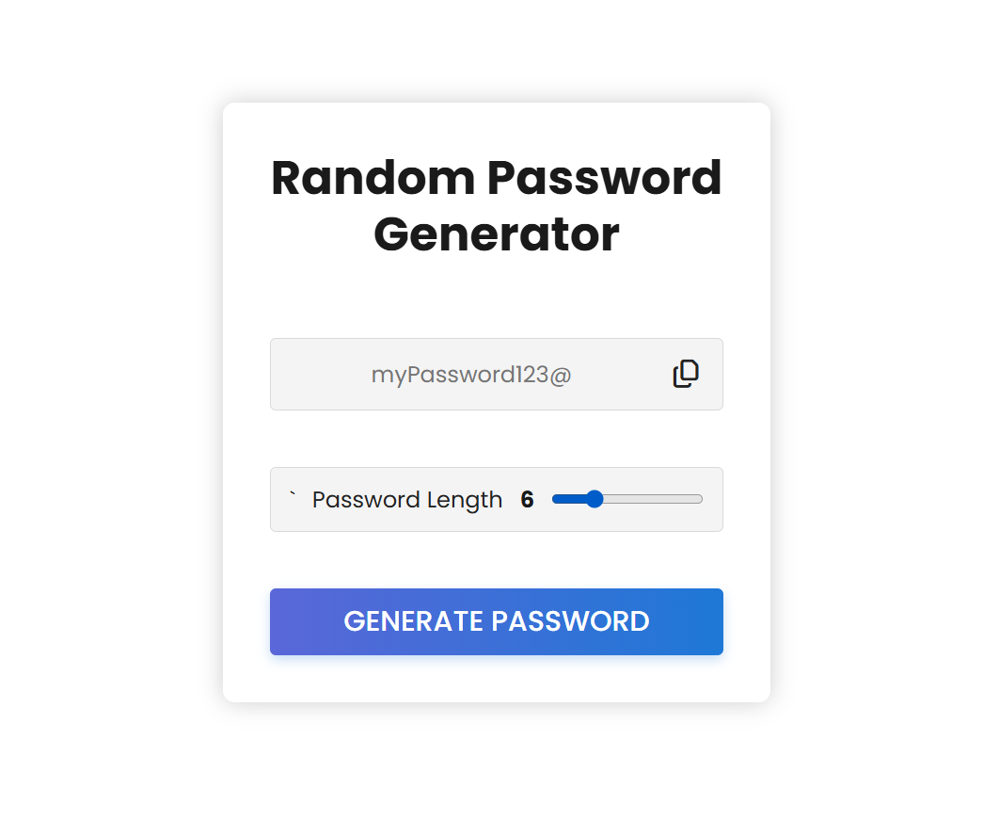

# 🎲 Random Password Generator

A simple random password generator built using HTML, CSS, and JavaScript.

Generate secure random passwords with ease.

# Random Password Generator

A simple and user-friendly password generator that creates random passwords with customizable lengths and a mix of uppercase letters, lowercase letters, numbers, and special characters.

## 📸 Preview

## ✨ Features

- Generate random passwords instantly.
- Customize password length using a range slider (4–12 characters).
- Includes uppercase and lowercase letters, numbers, and special characters.
- Copy generated passwords to the clipboard.
- Displays copy confirmation with a tooltip and icon change.
- Clean and responsive user interface.

## 🛠️ Technologies Used

- HTML5
- CSS3
- JavaScript

## 🧠 JavaScript Concepts Practiced

- DOM Manipulation
- Event Listeners
- Arrow Functions
- Variables (`let`)
- String Concatenation
- `Math.random()` & `Math.floor()`
- `while` Loop
- Event Object (`evt.target`)
- Async/Await
- Clipboard API
- `setTimeout()`

---

### 💻 About This Project

This project was built to practice JavaScript fundamentals and DOM manipulation while creating a useful, interactive application.

**Made with ❤️ using HTML, CSS & JavaScript.**
